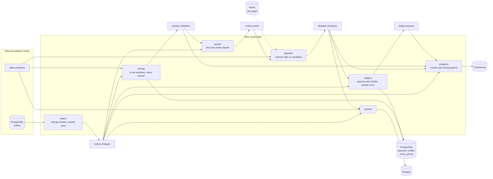

# half-time

A delivery platform on the night of a world final, run as a stream on
[clink](https://github.com/orhaugh/clink). Three cities order food through
ninety minutes, extra time and penalties, and a billion people order at once
at half-time. Riders report where they are every twelve seconds, and stop
reporting when they stop to watch a goal. Every order moves through its life
in a PostgreSQL order store, and everything the platform does with it happens
in clink: the order stream is announced exactly once, each zone is priced
every minute from the last five minutes of demand and supply, each order is
quoted under the price it was placed at, assigned to the nearest rider or
escalated, and when it is delivered the rider is paid and a late customer is
credited, exactly once, in PostgreSQL. Everything is also counted in
ClickHouse and archived as Parquet.

It is a deliberately convoluted pipeline, because real ones are. Seven jobs
read and write six Kafka topics, a PostgreSQL change stream, two PostgreSQL
ledgers and a price table, a Neo4j city graph, four ClickHouse tables and
three Parquet archives, and the outputs of one job are the inputs of the next.
A worker is killed in the middle of the half-time surge, a producer resends a
batch it had already delivered, and every store is then checked, row by row,
against a reference model that never touched clink.

## What it shows

- **One order store, read once.** The order service writes PostgreSQL and
  nothing else. clink reads the table's replication stream and announces each
  change exactly once on Kafka; every other job reads that topic.
- **Outputs that are inputs.** Pricing windows price the quotes, quotes feed
  the dispatcher, dispatch decisions and delivery events meet in the ledger,
  and the ledger's payouts feed the analytics store. Each hop is a Kafka topic
  written in a transaction committed with the job's checkpoint, so a job reads
  only what the job before it has committed.
- **Event time, under a kill.** Prices, quotes and dispatch decisions are
  windows in event time, so the results depend on when things happened, not
  on when they arrived. The worker that is killed mid-surge comes back from
  its last checkpoint, and the reference model does not notice.
- **One guarantee per output, each declared.** The order stream, the quotes,
  the decisions, the payouts and the credits are written exactly once. The
  price table is kept by upsert. The analytics store is written at least
  once and collapses the copies. The archive is published exactly once, by
  rename on checkpoint.
- **A graph in the hot path.** Where a restaurant is and which zones touch its
  own come from Neo4j, looked up per order, inside the dispatch query.
- **Failure on purpose.** A worker is killed with SIGKILL at half-time and a
  producer resends two thousand position reports. Every topic and table is
  then checked against what the night's data says it must hold.

## How it works



| Job | Reads | Writes | Guarantee |
| --- | --- | --- | --- |
| `orders` | the order table's replication stream | `orders.changes` | exactly once |
| `pricing` | `orders.changes`, `riders.positions` | `pricing.multipliers`; `zone_pricing` in PostgreSQL | exactly once; upsert |
| `quotes` | `orders.changes`, `pricing.multipliers` | `orders.priced` | exactly once |
| `dispatch` | `orders.priced`, `riders.positions`, the Neo4j graph | `dispatch.decisions` | exactly once |
| `ledgers` | `orders.changes`, `dispatch.decisions` | `payouts` and `credits` in PostgreSQL; `ledger.payouts` | exactly once |
| `analytics` | the four topics above | five ClickHouse tables, one of them each customer's running spend | at least once |
| `archive` | `orders.changes`, `riders.positions`, `dispatch.decisions` | three Parquet directories | exactly once |

Each job is one SQL file under `pipeline/`, submitted to a Coordinator and
two Workers. The same files run embedded with `clink run`.

### The rules

**Pricing** (`pipeline/pricing.sql`). For every zone, a five-minute window
sliding every minute counts the orders placed in it and the riders who
reported from it. The multiplier is 1.00x below one order per rider, 1.20x
from one, 1.50x from two, 1.80x from three, and 2.00x when no rider reported
at all. Each window is published once and kept as the zone's current price.

**Quotes** (`pipeline/quotes.sql`). An order is priced by the window that
closed in the minute it was placed, the latest price the zone had; a zone
with nothing to show for five minutes is priced at 1.00x. The quote carries
`decide_at`, two minutes after the order, which is when the dispatcher stops
waiting for riders to report in.

**Dispatch** (`pipeline/dispatch.sql`). The graph gives the restaurant's
position, its zone and the zones that touch it. Every report from those
zones between three minutes before the order and two minutes after it, and
within 1,500 m of the restaurant, is a candidate; the nearest wins, the lower
rider id on a tie, and an order with no candidate is escalated. The decision
is a window over the join, closed at `decide_at`, so every report that could
count has arrived before the rider is chosen.

**Ledgers** (`pipeline/ledgers.sql`). A payout is the delivery fee at the
quoted multiplier, recorded when the order store says the order was
delivered, to the rider the dispatcher chose. The delivery and the decision
meet in a join keyed by the order that keeps each side for ten minutes of
wall-clock time, so a dispatcher running late still finds the delivery
waiting. A credit is a fifth of the basket when a delivery came more than
ten minutes after the promise, or the basket when the order was cancelled.

**Analytics** (`pipeline/analytics.sql`). Every change, decision, pricing
window and payout lands in ClickHouse as a row. Each customer's running
spend is clink's event-time window over the order stream, which arrives in
the order the order store committed it. A rider's running pay is a ClickHouse
view over the payout rows instead: a payout is recorded when the later of the
delivery and the dispatch decision arrives, so payouts do not arrive in
delivery order, and an event-time running total would have to drop the ones
that arrive behind its watermark.

### Why each hop is a topic

The dispatcher could read the order table and compute its own quote. It does
not, because the quote is a fact the platform has already told the customer,
and because a job that reads only committed records of the job before it can
be restarted on its own, from its own checkpoint, without re-deciding what
an earlier job decided. Each topic written exactly once is a boundary a
restore cannot cross twice.

## Running it

You need Docker, Python 3 and a clink build (the `clink` and `clink_node`
binaries). Nothing else is installed on the host: the producer and the checks
run Kafka's own tools inside the broker container, `psql` inside PostgreSQL's
and `clickhouse-client` inside ClickHouse's.

```bash
CLINK_BIN_DIR=/path/to/clink/build ./run.sh
```

`run.sh` generates the night, starts the broker, the order store, the city
graph and the analytics store from empty, starts clink, submits the seven
jobs, plays the night at thirty times real time (six minutes), kills Worker 1
at half-time and starts it again, resends a batch of reports, and checks
every store. `SPEED=10` plays it slower; `CLEANUP=1` removes everything at
the end. `DISPATCH_PARALLELISM=3` runs the dispatcher as three subtasks;
every job otherwise runs as one. That needs a clink built after the fix to
how a keyed row's state is filed for a restore, which the first run at
parallelism three found. The stack otherwise stays up: Neo4j Browser is at
http://localhost:7474, the Coordinator at http://localhost:8081, and
ClickHouse answers on port 29000.

## What the checks prove

`tools/check_run.py` compares every store with `tools/reference.py`, a model
of the same rules computed from the generated night alone, in event time:

| Store | Held to |
| --- | --- |
| `orders.changes` | every change the order store committed, once |
| `pricing.multipliers`, `zone_pricing` | every window that closed, once, with the values the model computes; each zone at its latest window |
| `orders.priced` | every order, once, under the model's multiplier |
| `dispatch.decisions` | every order, once, with the model's rider, candidate count and score |
| `payouts`, `credits`, `ledger.payouts` | every payout and credit, once, to the cent |
| the ClickHouse tables | every row at least once, the copies counted; each customer's spend as the model computes it; each rider's total as the view computes it from the rows |
| the Parquet archives | every record of each stream, once |
| the Neo4j graph | the generated cities, zones and restaurants |

The night ends, and a stream does not. The checks require every row the
stream's watermark could have reached: the pricing windows up to the last
minute, the decisions whose window closed before the quotes stopped, and the
running spend up to the lowest partition's last delivery. A row past that
point is held to the same standard when it appears, and the check reports
how many were still waiting. In the run above, every one of the 98 orders
still inside their dispatch window when the quotes stopped was decided once
the idle timeout released them, and seven of 5,291 spend rows were still
waiting on a partition that had ended early.

### Idle partitions

Every topic here has three partitions and nothing carries a key, so each
job's transactional sink puts a burst of records, such as one minute's
quotes, on whichever partition its producer is on. A partition can go six
minutes of match time without a record while the others move on. clink
tracks a watermark per partition and takes the lowest, which is what keeps a
quiet partition's records from arriving late, so without idleness handling
the dispatcher's watermark would freeze at the quiet partition's last record
and the orders behind it would never be decided. Every table therefore sets
`idle_timeout_ms` to ninety seconds: a partition that has been quiet that
long is set aside until it speaks again. The trade-off is at start-up, where
a derived topic is empty until the job before it has committed its first
rows; ninety seconds is several times longer than that takes here, and a
shorter setting cost one quote its multiplier in an earlier run.

## What is generated

`tools/world.py` draws the night from one seed: three cities of nine zones
each, 36 restaurants, 1,200 customers, 216 riders and about 5,500 orders,
some 21,000 changes to them and 190,000 position reports. Orders arrive at
rates set by the match: fewer during play, a surge for two minutes after each
goal, three times the rate at half-time, a lull during penalties and a rush
after the whistle. Half the riders stop for six to twelve minutes after a
goal or for the penalties. Riders work near a restaurant, the busier the
likelier, so a quiet restaurant can find no rider within reach.

## Status

Round 1: the core pipeline above, on one machine. Later rounds add
restaurant and partner messaging (Pulsar, RabbitMQ, NATS), rider devices
(MQTT), the rider app's own store (MongoDB), the legacy menu system (MySQL
change data capture), search, metrics, a lakehouse on object storage, the
operational scenes (a live rescale during the surge, a schema change
mid-run, a savepoint, a coordinator failover) and a scale-out on real
hardware.

## Licence

Apache License 2.0. See `LICENSE` and `NOTICE`.
