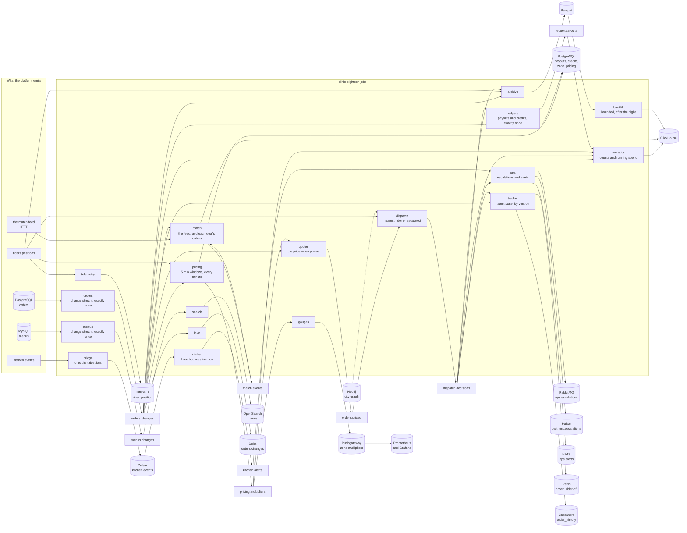

# half-time

A delivery platform on the night of a world final, run as a stream on
[clink](https://github.com/orhaugh/clink). Three cities order food through
ninety minutes, extra time and penalties, and a billion people order at once
at half-time. Riders report where they are every twelve seconds, and stop
reporting when they stop to watch a goal. Every order moves through its life
in a PostgreSQL order store, and everything the platform does with it happens
in clink: the order stream is announced exactly once, each zone is priced
every minute from the last five minutes of demand and supply, each order is
quoted under the price it was placed at, assigned to the nearest rider or
escalated, and when it is delivered the rider is paid and a late customer is
credited, exactly once, in PostgreSQL. Everything is also counted in
ClickHouse and archived as Parquet. Around the core, the restaurants' menus
live in a MySQL system that will stay MySQL, their tablets talk on Pulsar, a
kitchen that bounces three orders in a row is reported to the floor over
NATS, an order no rider was near goes to the operations desk's RabbitMQ queue
and to the partners' Pulsar topic, and every order's latest state is kept in
Redis and its history in Cassandra. The broadcaster's feed is polled over
HTTP and each goal's surge of orders is counted, every menu change is
indexed in OpenSearch, every rider position is a point in InfluxDB, the order
stream is a Delta table, each zone's multiplier is a gauge Prometheus scrapes
and Grafana shows beside clink's own metrics, and after the night a bounded
job reads the dispatch archive back.

It is a deliberately convoluted pipeline, because real ones are. Eighteen
jobs read and write ten Kafka topics, a PostgreSQL change stream, a MySQL
change stream, an HTTP feed, two PostgreSQL ledgers and a price table, a
Neo4j city graph, eight ClickHouse tables, three Parquet archives, a Delta
table, two Pulsar topics, a RabbitMQ queue, a NATS stream, two Redis
keyspaces, a Cassandra table, an OpenSearch index, an InfluxDB bucket and a
Pushgateway, and the outputs of one job are the inputs of the next. A worker is killed in the
middle of the half-time surge, producers resend batches they had already
delivered, and every store is then checked, row by row, against a reference
model that never touched clink.

## What it shows

- **One order store, read once.** The order service writes PostgreSQL and
  nothing else. clink reads the table's replication stream and announces each
  change exactly once on Kafka; every other job reads that topic.
- **Outputs that are inputs.** Pricing windows price the quotes, quotes feed
  the dispatcher, dispatch decisions and delivery events meet in the ledger,
  and the ledger's payouts feed the analytics store. Each hop is a Kafka topic
  written in a transaction committed with the job's checkpoint, so a job reads
  only what the job before it has committed.
- **Event time, under a kill.** Prices, quotes and dispatch decisions are
  windows in event time, so the results depend on when things happened, not
  on when they arrived. The worker that is killed mid-surge comes back from
  its last checkpoint, and the reference model does not notice.
- **One guarantee per output, each declared.** The order stream, the quotes,
  the decisions, the payouts and the credits are written exactly once. The
  price table is kept by upsert. The analytics store is written at least
  once and collapses the copies. The archive is published exactly once, by
  rename on checkpoint.
- **A graph in the hot path.** Where a restaurant is and which zones touch its
  own come from Neo4j, looked up per order, inside the dispatch query.
- **Two change streams, two databases.** The order store is PostgreSQL,
  read through a replication slot; the menu system is MySQL, read from its
  binary log, the existing rows first as a snapshot at a consistent position.
  Each is announced on Kafka exactly once, and neither system knows.
- **A pattern over a bus that repeats itself.** The tablets' events arrive on
  Pulsar, which delivers at least once. The kitchen job makes them distinct
  before `MATCH_RECOGNIZE` looks for three bounces in a row per restaurant,
  in event time, so a repeated event, from a restart or a retry, cannot count
  as a bounce of its own. The alert itself goes out at least once: Pulsar
  hands clink no position to replay from, only redelivery of what was not
  acknowledged, and clink's planner holds a job over such a source to what
  that supports, however the sink is declared. The same redelivery arrives
  after the newer messages when a consumer restarts, so the watch allows the
  bus forty-five minutes of match-time lateness, which at thirty times real
  time is the ninety seconds a restart and a redelivery take; a source clink
  replays from a position of its own needs a minute.
- **Stores kept by key.** The tracker ranks each order's changes by version
  and keeps the top one in Redis, so a change that arrives behind a later one
  cannot win, and the key is replaced or restored as the ranking changes.
  Cassandra holds every change as a row keyed by order and time. A restart
  that writes a state again changes nothing in either.
- **Sinks that declare what they are.** clink's planner computes each job's
  guarantee from its sources and sinks and refuses a declaration the path
  cannot honour. A sink over the Pulsar bus cannot claim exactly once,
  because the bus redelivers rather than replays, and the SQL says so. The
  polled match feed checkpoints its cursor and the feed honours it, so its
  events reach Kafka exactly once through a transactional sink, and the
  planner accepts that declaration because the connector's record now says
  what its code does.
- **The archive is an input too.** After the night a bounded job reads the
  dispatch archive's Parquet files back into a table beside the live one.
- **Failure on purpose.** A worker is killed with SIGKILL at half-time, a
  producer resends two thousand position reports and another five hundred
  tablet events. Every topic, queue, stream, key and table is then checked
  against what the night's data says it must hold.
- **The operational scenes.** A standby Coordinator stands by from the
  start. At minute 75 the gauges job is stopped at a savepoint, which commits
  its tail, and resubmitted from that savepoint as a new job. At minute 95
  the leading Coordinator is killed; the standby takes the leader lock,
  binds its ports, and recovers all seventeen jobs from their checkpoints,
  with the Workers following it through the HA directory. The checks do not
  notice either.
- **The protocol, recorded against its specification.** Every clink process
  records the steps of the exactly-once protocol it takes (checkpoint
  triggers, acknowledgements, completions, commits, restores): some 115,000
  events across the two Coordinators and the Workers of a run, under
  `state/run/traces`. clink's specification has a trace validator that
  accepts a run only if every step is one the specification allows in that
  state, and it reads one job at a time; the sink-side events do not yet
  carry the job id, so a seventeen-job trace is not separable and the
  validation waits for that (`TRACE_CHECK=1` runs it regardless).

## How it works



| Job | Reads | Writes | Guarantee |
| --- | --- | --- | --- |
| `orders` | the order table's replication stream | `orders.changes` | exactly once |
| `pricing` | `orders.changes`, `riders.positions` | `pricing.multipliers`; `zone_pricing` in PostgreSQL | exactly once; upsert |
| `quotes` | `orders.changes`, `pricing.multipliers` | `orders.priced` | exactly once |
| `dispatch` | `orders.priced`, `riders.positions`, the Neo4j graph | `dispatch.decisions` | exactly once |
| `ledgers` | `orders.changes`, `dispatch.decisions` | `payouts` and `credits` in PostgreSQL; `ledger.payouts` | exactly once |
| `analytics` | the four topics above | five ClickHouse tables, one of them each customer's running spend | at least once |
| `archive` | `orders.changes`, `riders.positions`, `dispatch.decisions` | three Parquet directories | exactly once |
| `menus` | the menu table's binary log, snapshot first | `menus.changes` | exactly once |
| `bridge` | `kitchen.events` | the Pulsar topic `kitchen.events` | at least once |
| `kitchen` | the Pulsar topic `kitchen.events` | `kitchen.alerts` | at least once |
| `ops` | `dispatch.decisions`, `kitchen.alerts` | the RabbitMQ queue `ops.escalations`, the Pulsar topic `partners.escalations`, the NATS subject `ops.alerts` | at least once |
| `tracker` | `orders.changes`, `dispatch.decisions` | the Redis keys `order:` and `rider-of:`; `order_history` in Cassandra | upsert; at least once by key |
| `search` | `menus.changes` | the OpenSearch index `menus`, one document per change | at least once, by document |
| `match` | the match feed over HTTP, `match.events`, `orders.changes` | `match.events`; `match_timeline` and `goal_orders` in ClickHouse | exactly once; at least once |
| `lake` | `orders.changes` | the Delta table `lake/orders.changes` | at least once |
| `telemetry` | `riders.positions` | the InfluxDB measurement `rider_position` | at least once, one point per series and time |
| `gauges` | `pricing.multipliers` | the Pushgateway gauge `halftime_zone_multiplier_pct`, scraped by Prometheus | at least once |
| `backfill` | the dispatch archive's Parquet files, after the night | `dispatch_decisions_backfill` in ClickHouse | at least once; bounded |

Each job is one SQL file under `pipeline/`, submitted to a Coordinator and
two Workers. The same files run embedded with `clink run`.

### The rules

**Pricing** (`pipeline/pricing.sql`). For every zone, a five-minute window
sliding every minute counts the orders placed in it and the riders who
reported from it. The multiplier is 1.00x below one order per rider, 1.20x
from one, 1.50x from two, 1.80x from three, and 2.00x when no rider reported
at all. Each window is published once and kept as the zone's current price.

**Quotes** (`pipeline/quotes.sql`). An order is priced by the window that
closed in the minute it was placed, the latest price the zone had; a zone
with nothing to show for five minutes is priced at 1.00x. The quote carries
`decide_at`, two minutes after the order, which is when the dispatcher stops
waiting for riders to report in.

**Dispatch** (`pipeline/dispatch.sql`). The graph gives the restaurant's
position, its zone and the zones that touch it. Every report from those
zones between three minutes before the order and two minutes after it, and
within 1,500 m of the restaurant, is a candidate; the nearest wins, the lower
rider id on a tie, and an order with no candidate is escalated. The decision
is a window over the join, closed at `decide_at`, so every report that could
count has arrived before the rider is chosen.

**Ledgers** (`pipeline/ledgers.sql`). A payout is the delivery fee at the
quoted multiplier, recorded when the order store says the order was
delivered, to the rider the dispatcher chose. The delivery and the decision
meet in a join keyed by the order that keeps each side for ten minutes of
wall-clock time, so a dispatcher running late still finds the delivery
waiting. A credit is a fifth of the basket when a delivery came more than
ten minutes after the promise, or the basket when the order was cancelled.

**Analytics** (`pipeline/analytics.sql`). Every change, decision, pricing
window and payout lands in ClickHouse as a row. Each customer's running
spend is clink's event-time window over the order stream, which arrives in
the order the order store committed it. A rider's running pay is a ClickHouse
view over the payout rows instead: a payout is recorded when the later of the
delivery and the dispatch decision arrives, so payouts do not arrive in
delivery order, and an event-time running total would have to drop the ones
that arrive behind its watermark.

### Why each hop is a topic

The dispatcher could read the order table and compute its own quote. It does
not, because the quote is a fact the platform has already told the customer,
and because a job that reads only committed records of the job before it can
be restarted on its own, from its own checkpoint, without re-deciding what
an earlier job decided. Each topic written exactly once is a boundary a
restore cannot cross twice.

## Running it

You need Docker, Python 3 and a clink build (the `clink` and `clink_node`
binaries). Nothing else is installed on the host: the producers and the
checks run each system's own tools inside its container, Kafka's in the
broker's, `psql` in PostgreSQL's, `clickhouse-client` in ClickHouse's,
`mysql`, `pulsar-client`, `redis-cli` and `cqlsh` in theirs, the `nats`
command line in a throwaway container on the compose network, and RabbitMQ,
OpenSearch, InfluxDB and the Pushgateway over HTTP. The fifteen containers
want about eight gigabytes of memory between them; Kafka, Cassandra,
ClickHouse, OpenSearch and Pulsar take most of it.

```bash
CLINK_BIN_DIR=/path/to/clink/build ./run.sh
```

`run.sh` generates the night, starts every system from empty, starts the
match feed and clink, submits the seventeen streaming jobs, plays the night
at thirty times real time (six minutes), kills Worker 1 at half-time and
starts it again, resends a batch of reports and a batch of tablet events,
runs the backfill, and checks every store. `SCENES=0` leaves out the
standby Coordinator, the savepoint and the failover; otherwise they are part
of every run. `SPEED=10` plays it slower; `CLEANUP=1` removes everything at
the end. `DISPATCH_PARALLELISM=3` runs the dispatcher as three subtasks;
every job otherwise runs as one. That needs a clink built after the fix to
how a keyed row's state is filed for a restore, which the first run at
parallelism three found. The stack otherwise stays up: Neo4j Browser is at
http://localhost:7474, RabbitMQ's management UI at http://localhost:15672,
Grafana at http://localhost:23000 (admin / halftime, with the half-time
dashboard provisioned from `deploy/grafana`), Prometheus at
http://localhost:29090, the Coordinator at http://localhost:8081, and
ClickHouse answers on port 29000.

## Running it on a rig

The same pipeline scales out on Hetzner Cloud, one host per system group
and as many Workers as the project's quota allows, with the scripts under
`rig/`. Nothing in them has been run against a real project yet: the dry
runs are what this round delivers, and the first real run is a decision
with a bill.

```bash
RUN_ID=final-20261101 ./rig/provision.sh --dry      # the plan and the hourly price, nothing created
RUN_ID=final-20261101 ./rig/run.sh --dry            # every step and command of a run, nothing connected
RUN_ID=final-20261101 HT_HCLOUD_CONTEXT=<context> ./rig/provision.sh
RUN_ID=final-20261101 CELLS=12 RIDERS_PER_CELL=300 WORKERS=3 SLOTS=32 FEEDERS=4 ./rig/run.sh
./rig/teardown.sh final-20261101 && ./rig/teardown.sh --check
```

`provision.sh` creates a private network, an ops host that exports the
shared state over NFS, two Coordinator hosts, `WORKERS` Worker hosts and
one host each for Kafka, the stores (PostgreSQL, Neo4j, ClickHouse, MySQL),
the messaging systems (Pulsar, RabbitMQ, NATS, Redis, Cassandra) and search
and telemetry (OpenSearch, InfluxDB), every resource labelled with the run
id, and a firewall that opens ssh, the Coordinators' HTTP ports and the
dashboards to the operator's address only. Its dry run prices the plan from
Hetzner's own list: the default of three shared-core Workers comes to about
EUR 0.77 an hour. `run.sh` does over ssh what the local `run.sh` does on one
machine: the role compose files under `rig/roles` start each system group
on its host advertising its private address, clink runs from the runtime
image (`CLINK_IMAGE`) with the HA directory, the checkpoints and the
protocol trace on the shared state, the night is generated at the chosen
scale on the ops host and played by `FEEDERS` processes per stream, a Worker
container is killed at half-time, and the checks run on the ops host against
every system by address (`tools/hosts.py`, `HT_MODE=rig`). The keyed jobs
run at `PARALLELISM` (default a quarter of the rig's slots); the change
streams, the bridge and the feed poller run as one subtask, as their
sources are single readers. `teardown.sh` removes everything by label, and
its `--check` is the end of every session.

## What the checks prove

`tools/check_run.py` compares every store with `tools/reference.py`, a model
of the same rules computed from the generated night alone, in event time:

| Store | Held to |
| --- | --- |
| `orders.changes` | every change the order store committed, once |
| `pricing.multipliers`, `zone_pricing` | every window that closed, once, with the values the model computes; each zone at its latest window |
| `orders.priced` | every order, once, under the model's multiplier |
| `dispatch.decisions` | every order, once, with the model's rider, candidate count and score |
| `payouts`, `credits`, `ledger.payouts` | every payout and credit, once, to the cent |
| the ClickHouse tables | every row at least once, the copies counted; each customer's spend as the model computes it; each rider's total as the view computes it from the rows |
| the Parquet archives | every record of each stream, once |
| the Neo4j graph | the generated cities, zones and restaurants |

`tools/check_round2.py` and `tools/check_round3.py` do the same for the
systems around the core:

| Store | Held to |
| --- | --- |
| `menus.changes`, the MySQL table | the menu store's rows as the night began and every change, once, with the values written; each item at its final state |
| the Pulsar topic `kitchen.events` | every tablet event at least once, the copies counted |
| `kitchen.alerts` | every run of three bounces at a restaurant, at least once, naming the model's three orders |
| the RabbitMQ queue, the Pulsar topic `partners.escalations` | every escalated order at least once |
| the NATS stream `ALERTS` | every alert at least once |
| the Redis keys | every order at its final state; every assigned order's rider |
| the Cassandra table | every change to every order at least once, the copies counted |
| the OpenSearch index | every menu change as one document, with the values written |
| `match.events`, `match_timeline`, `goal_orders` | every event once on the topic and at least once in the timeline; every order placed in the two minutes from a goal, against that goal |
| the Delta table | every change at least once, read back by ClickHouse from the files the log commits |
| the InfluxDB measurement | one point per report, exactly: the store keeps one value per series and time |
| the Pushgateway | each zone's multiplier equal to the topic's row for the window it names, at or near the latest |
| `dispatch_decisions_backfill` | every decision the archive holds, as the topic has it |
| the protocol trace | recorded for every process; checked against the exactly-once specification once the trace vocabulary carries the job id (`TRACE_CHECK=1` with `CLINK_SRC` set to a clink checkout runs `scripts/formal-check.sh --trace` today) |

The night ends, and a stream does not. The checks require every row the
stream's watermark could have reached: the pricing windows up to the last
minute, the decisions whose window closed before the quotes stopped, and the
running spend up to the lowest partition's last delivery. A row past that
point is held to the same standard when it appears, and the check reports
how many were still waiting. In the run above, every one of the 98 orders
still inside their dispatch window when the quotes stopped was decided once
the idle timeout released them, and seven of 5,291 spend rows were still
waiting on a partition that had ended early.

### Idle partitions

Every topic here but one has three partitions and nothing carries a key, so
each job's transactional sink puts a burst of records, such as one minute's
quotes, on whichever partition its producer is on. (`kitchen.events` has one
partition: the tablet vendor's bus is ordered, and the bridge keeps it so.) A partition can go six
minutes of match time without a record while the others move on. clink
tracks a watermark per partition and takes the lowest, which is what keeps a
quiet partition's records from arriving late, so without idleness handling
the dispatcher's watermark would freeze at the quiet partition's last record
and the orders behind it would never be decided. Every table therefore sets
`idle_timeout_ms` to ninety seconds: a partition that has been quiet that
long is set aside until it speaks again. The trade-off is at start-up, where
a derived topic is empty until the job before it has committed its first
rows; ninety seconds is several times longer than that takes here, and a
shorter setting cost one quote its multiplier in an earlier run.

## What it costs

`tools/footprint.py` samples clink's processes from their own `/metrics` and
every container from `docker stats` through a run, and the run ends with the
figures. On one machine at thirty times real time, with the scenes, the
seventeen jobs and the backfill ran in four clink processes whose peaks
summed to 1.0 GiB: the Coordinator 43 MiB, its standby 39 MiB, the two
Workers 501 MiB and 448 MiB (means of 232 MiB and 209 MiB), at 21 and 19
per cent of a core on average. The fifteen systems they fed peaked at
8.2 GiB between them; Kafka, Cassandra, ClickHouse, OpenSearch and Pulsar
each above a gigabyte. The clink binaries were a host debug build; the runtime image is
a release build and does better on both counts. A run without the scenes
(`SCENES=0`) on an otherwise quiet machine gives the cleaner figure.

## What it found

A pipeline this wide is a test of the engine, and the first runs of each
round were. Each of these was reproduced in clink's own tests and fixed
there before the round was called done:

- A keyed row's state was filed under one key group and its rows routed
  by another, so a Worker kill at parallelism three lost two thirds of the
  dispatch join's buffered reports and decided 378 orders with fewer riders
  than it had seen.
- A job over a source its broker redelivers (Pulsar, RabbitMQ, NATS) was
  reported as losing what was in flight and refused even an `at_least_once`
  declaration, where at least once is exactly what such a source gives.
- In a statement set, a Top-N statement left a flag set that made the next
  statement drop its `WHERE`: the tracker wrote every order's rider instead
  of the assigned ones'.
- `MATCH_RECOGNIZE` matched `b{3}` across rows that were not bounces, so 269
  kitchens were reported overloaded where the night held 59 runs of three.
- A numeric value a text-protocol source delivered as `"2000"` stayed a
  string in a `BIGINT` column, through Kafka and into OpenSearch.
- The Redis upsert sink wrote `order:"lisbon-o00940"\x1f` where its page
  promised `order:lisbon-o00940`.
- The HTTP polling source's capability record said it kept no cursor and
  sat outside checkpointing, while its code checkpoints the cursor and
  re-polls from it; the record barred a job over the feed from declaring
  any guarantee.

Still open, and noted here rather than hidden: SQL jobs declare no rescale
bounds, so a running SQL job cannot be rescaled live; the Pulsar source
hands a restarted consumer its unacknowledged messages after the newer
ones, where a seek to the oldest of them would replay in order; the
protocol trace's sink events carry no job id, so a run of many jobs cannot
be validated against the specification job by job; and MQTT and MongoDB
are not reachable from SQL.

## Dissecting it

Everything the run does is in plain files, and clink shows its working.
With the stack up after a run (`run.sh` leaves it up):

- A job's plan, without running it:
  `clink run pipeline/dispatch.sql --explain` prints the logical plan the
  planner built, join shape and all.
- A job's guarantee, as the planner computed it from its sources and sinks:
  `curl -s localhost:8081/api/v1/jobs/4 | python3 -m json.tool` shows
  `delivery_guarantee`, what limits it and the reasoning
  (`guarantee_reasons`); try the kitchen job, held to at least once, beside
  the dispatcher, exactly once. Job ids follow the submission order in
  `run.sh`. After the failover the Coordinator is on port 8084.
- What each operator received, emitted and dropped:
  `curl -s localhost:8081/api/v1/jobs/4/operators`. `run.sh` keeps the
  kitchen job's counters from before the failover and from the end under
  `state/run/kitchen-operators-*.json`.
- The state inside a checkpoint: `clink state-cat
  --file state/run/checkpoints/_state/10/v1/1/checkpoint-<n>.snap` dumps the
  kitchen job's `distinct` set (one entry per tablet event) and the pattern
  operator's held rows (`__cep_held__`), keyed by the restaurant's key
  group; `clink state-diff` compares two checkpoints.
- The model the checks compare against: `python3 tools/reference.py`
  prints its counts, and `tools/reference.py` mirrors each job's rules in
  plain Python, one function per job, so a check line can be traced to the
  rule it holds.
- The protocol trace: `state/run/traces/*.ndjson`, one JSON object per
  protocol step per process, in the vocabulary of `formal/trace/events.txt`
  in the clink repository.
- The dashboards: Grafana at http://localhost:23000 shows clink's own
  metrics (memory, CPU, checkpoints, subtasks per Worker) beside the zone
  multipliers the gauges job pushes; Prometheus at http://localhost:29090
  has the raw series.
- The systems themselves: every container keeps its native tools, as the
  checks use them (`docker compose exec kafka ...`, `psql`,
  `clickhouse-client`, `cqlsh`, `redis-cli`, `pulsar-client`), and
  `tools/hosts.py` is the one place that knows where each one is.

## What is generated

`tools/world.py` draws the night from one seed: three cities of nine zones
each, 36 restaurants, 1,200 customers, 216 riders and about 5,500 orders,
some 21,000 changes to them and 190,000 position reports. Orders arrive at
rates set by the match: fewer during play, a surge for two minutes after each
goal, three times the rate at half-time, a lull during penalties and a rush
after the whistle. Half the riders stop for six to twelve minutes after a
goal or for the penalties. Riders work near a restaurant, the busier the
likelier, so a quiet restaurant can find no rider within reach. The kitchens
and the menus are drawn apart from the rest, so they can change without a
single order or report changing: 288 menu items and 178 changes to them
through the night, and some 11,600 tablet events, of which about 800 are
bounces, clustered at the busiest kitchens in the busiest minutes, so that
59 runs of three reach the floor. The match feed is ten events: kick-off,
four goals, half-time, the second half, extra time, the penalties and the
final whistle, each at the start of its minute, which is when the orders
surge.

## Status

Round 1: the core pipeline, on one machine. Round 2: the systems around
it (one open item: after the Coordinator failover the kitchen watch raises
three of forty-one alerts differently from the model, with every row
accounted for at the pattern operator's door, so the difference is in its
state across that restore and is being traced in clink; the check reports
it rather than hiding it), the legacy menu system (MySQL change data capture), the tablets' bus
(Pulsar), the desk, the partners and the floor (RabbitMQ, Pulsar, NATS) and
the tracker (Redis, Cassandra). Round 3: the match feed (HTTP polling),
search (OpenSearch), telemetry (InfluxDB), the lakehouse (Delta), the gauges
(Pushgateway, Prometheus, Grafana) and the backfill from the archive. Round
4: the operational scenes, a savepoint stop and resume, a Coordinator
failover, and the protocol trace checked against the specification. Round
5: the footprint sampler, so a run ends with what clink and each system
cost. Round 6: the rig scripts, dry-run only. A live
rescale of the dispatcher during the surge waits for SQL jobs to declare
rescale bounds, which clink's planner does not yet do; a job built on the
typed API declares them with `.rescalable(min, max)`. Rider devices (MQTT) and the rider app's
own store (MongoDB) are reached through clink's typed C++ API rather than
SQL, and wait for a round with a compiled job.

## Licence

Apache License 2.0. See `LICENSE` and `NOTICE`.
